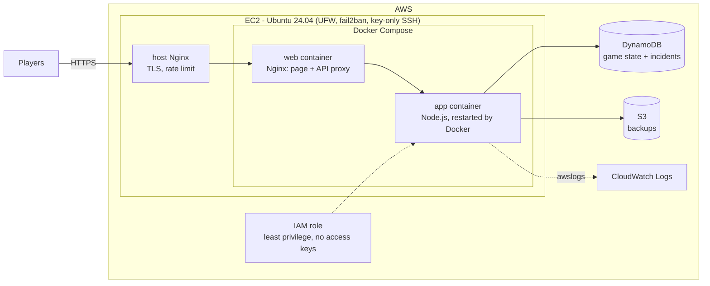

# Chaos Arena

**A multiplayer tug-of-war you're *allowed* to break.**
Pick Team Red or Team Blue and click to pull the rope, or smash the **CHAOS** button to crash the server on purpose. Then watch it heal itself while a live panel shows uptime, crash count and recovery time.

🌐 **Play it:** [https://chaos-arena.duckdns.org](https://chaos-arena.duckdns.org)

Chaos Arena is my project for the **Codomax Digital Solutions Cloud Computing & DevOps virtual internship**. Each module adds a new layer of cloud and DevOps engineering to the same app, so it gets more resilient with every module.

## Architecture (after Module 04)



**The trick that makes it survive a crash:** the game's state lives in DynamoDB, not in the container. When the process dies, Docker restarts the container (in under a second), the game reloads its state, and it measures how long the recovery took.

## Roadmap

| Module | Days | What it adds | Self-healing level | Status |
|---|---|---|---|---|
| [02 · Linux, Networking & Cloud Infrastructure](module-02-linux-networking/) | 6–10 | Hardened Ubuntu EC2 server, firewall, DNS, Nginx, HTTPS | — | ✅ Done |
| [03 · Cloud Services & Web App Deployment](module-03-cloud-services/) | 11–15 | Node.js game + DynamoDB + S3 + IAM role + CloudWatch logs | systemd restarts the app (~3.0 s) | ✅ Done |
| [04 · Docker & Containerization](module-04-docker/) | 16–20 | Multi-stage Dockerfiles, Docker Compose, container networking, volumes | Docker restart policy + health checks (~0.8 s) | 🚧 In progress |
| 05 · DevOps, CI/CD & Monitoring | 21–25 | GitHub Actions test + deploy, CloudWatch alarms, recovery-time charts | Pipeline + alarms | ⏳ |
| 06 · Capstone | 26–30 | Architecture diagram, final docs, demo | Full stack | ⏳ |

Each finished module is saved as a **git tag**, so you can see the project exactly as it was at that point, e.g.
`https://github.com/l3n8n-ocd/chaos-arena/tree/module-02`

## Tech stack
**AWS** (EC2, Elastic IP, Security Groups, DynamoDB, S3, IAM, CloudWatch) · **Ubuntu 24.04** · **Nginx** · **Let's Encrypt** · **DuckDNS** · **Node.js + Express** · **systemd** · **Docker / Compose** · **GitHub Actions** *(Module 05)*

## Repository layout
```
chaos-arena/
├── README.md                      ← you are here
├── compose.yaml                   ← the whole app as two containers (+ compose.aws.yaml for the server)
├── app/                           ← the game (Node.js API, web page, tests, Dockerfile)
├── docker/web/                    ← the web container (Nginx) image
├── infra/aws/                     ← scripts + policies that create the AWS resources
├── module-02-linux-networking/    ← server setup: scripts, configs, notes, evidence
├── module-03-cloud-services/      ← app deployment: scripts, systemd, Nginx, notes, evidence
├── module-04-docker/              ← containerization: scripts, host Nginx, notes, evidence
└── docs/screenshots/              ← screenshots for each module
```

## Run it locally
No AWS account needed: locally the game keeps its data in a Docker volume (or a file).

**With Docker** (the whole stack, like on the server):
```bash
docker compose up --build      # open http://localhost:8080 and press CHAOS
```

**With Node.js 20+ only:**
```bash
cd app
npm install
npm test            # automated tests
npm run dev:heal    # open http://localhost:3000 and press CHAOS
```

## Author
**Lenon Adriano** · B.S. Information Technology
Cloud Computing & DevOps Intern @ Codomax Digital Solutions
