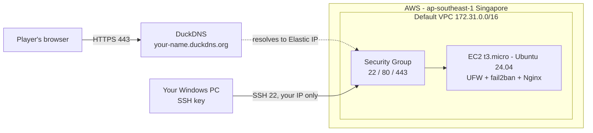

# Module 02 — Linux, Networking & Cloud Infrastructure

> **Goal:** set up the cloud server that Chaos Arena will run on:
> **Create VM → Configure Linux → Secure Access → Deploy Service → Test Connectivity**

By the end of this module you will have a hardened Ubuntu server on AWS with a free HTTPS domain, showing the Chaos Arena teaser page.



## What's in this folder

| Path | What it does |
|---|---|
| `scripts/01-system-setup.sh` | Updates Ubuntu, installs tools, sets hostname/timezone, adds swap |
| `scripts/02-users-and-permissions.sh` | Creates the `arena` group, `deployer` user and `/srv/chaos-arena` folder |
| `scripts/03-harden-ssh-and-firewall.sh` | Key-only SSH, no root login, UFW firewall, fail2ban |
| `scripts/04-install-nginx.sh` | Installs Nginx and publishes the teaser page + `/health` endpoint |
| `scripts/05-enable-https.sh` | Free Let's Encrypt HTTPS certificate with auto-renewal |
| `scripts/06-verify.sh` | Tests everything and prints an evidence report |
| `nginx/chaos-arena.conf` | The Nginx site configuration |
| `site/index.html` | The teaser page |
| `notes/` | My learning notes: Linux commands and networking concepts |
| `evidence/` | Verification output (screenshots live in `docs/screenshots/module-02/`) |

## Suggested schedule (under 1 hour a day)

| Day | Task | Time |
|---|---|---|
| Day 6 | Part A: AWS budget + launch EC2 + Elastic IP | ~45 min |
| Day 7 | Part B: connect from Windows, run scripts 01–03 | ~45 min |
| Day 8 | Part C: DuckDNS + scripts 04–05 (Nginx + HTTPS) | ~40 min |
| Day 9 | Part D: run 06-verify, take screenshots, push, tag | ~30 min |
| Day 10 | Post on LinkedIn and submit on the Codomax portal | ~20 min |

---

## Part A — Create the VM (AWS Console)

### A1. Protect yourself from charges first
Your account is on the AWS **Free plan** (credit-based). Charges are not possible while you stay on it, but it's still good practice (and earns bonus credits) to set a budget:

1. Top-right region menu → choose **Asia Pacific (Singapore) ap-southeast-1** (closest region to Southeast Asia).
2. Search **Billing and Cost Management** → **Budgets** → **Create budget** → **Use a template** → **Zero spend budget** → enter your email → **Create**.
3. Do **not** upgrade to the Paid plan.

### A2. Launch the EC2 instance
EC2 → **Launch instance**:

| Setting | Value |
|---|---|
| Name | `chaos-arena` |
| AMI | **Ubuntu Server 24.04 LTS**, 64-bit (x86) |
| Instance type | **t3.micro** (must say *Free tier eligible*) |
| Key pair | **Create new key pair** → name `chaos-arena-key`, type **ED25519**, format **.pem** → it downloads automatically. **Never upload this file to GitHub.** |
| Network settings → **Edit** | VPC: default · Auto-assign public IP: **Enable** · **Create security group** named `chaos-arena-sg` |
| Storage | **20 GiB gp3** (Docker images need room later) |

**Security group inbound rules** (the cloud firewall in front of the server):

| Type | Port | Source | Why |
|---|---|---|---|
| SSH | 22 | **My IP** | Only your computer can try to log in |
| HTTP | 80 | Anywhere-IPv4 (0.0.0.0/0) | Website + Let's Encrypt verification |
| HTTPS | 443 | Anywhere-IPv4 (0.0.0.0/0) | Secure website |

Click **Launch instance**. 📸 *Screenshot: instance list showing `chaos-arena` = Running.* 📸 *Screenshot: the security group's inbound rules.*

### A3. Give it a permanent IP (Elastic IP)
A normal public IP changes whenever the instance stops. Your domain needs one that never changes.

EC2 → **Elastic IPs** → **Allocate Elastic IP address** → **Allocate** → select it → **Actions → Associate Elastic IP address** → choose instance `chaos-arena` → **Associate**.

Write this IP down; it's called `<ELASTIC_IP>` below.

---

## Part B — Configure Linux & Secure Access

### B1. Connect from Windows (PowerShell)
Windows 10/11 already includes an SSH client. Open **PowerShell** and run:

```powershell
# Move the key into your .ssh folder
mkdir "$env:USERPROFILE\.ssh" -Force
Move-Item "$env:USERPROFILE\Downloads\chaos-arena-key.pem" "$env:USERPROFILE\.ssh\"

# Lock the key down so only you can read it (otherwise SSH refuses to use it)
icacls "$env:USERPROFILE\.ssh\chaos-arena-key.pem" /inheritance:r
icacls "$env:USERPROFILE\.ssh\chaos-arena-key.pem" /grant:r "$($env:USERNAME):(R)"

# Open (or create) your SSH config file in Notepad
notepad "$env:USERPROFILE\.ssh\config"
```

Paste this into the config file (replace `<ELASTIC_IP>`), save, and close Notepad:

```
Host chaos-arena
    HostName <ELASTIC_IP>
    User ubuntu
    IdentityFile ~/.ssh/chaos-arena-key.pem

Host chaos-arena-deployer
    HostName <ELASTIC_IP>
    User deployer
    IdentityFile ~/.ssh/chaos-arena-key.pem
```

> Notepad may save it as `config.txt`. If `ssh chaos-arena` says it can't resolve the hostname, rename the file to just `config` (no extension).

Connect:
```powershell
ssh chaos-arena
```
Type `yes` the first time. You should see `ubuntu@ip-172-31-...:~$`. 📸 *Screenshot: successful SSH login.*

> **Tip:** VS Code → install the **Remote - SSH** extension → bottom-left `><` icon → *Connect to Host* → `chaos-arena`. You'll use this for Docker in Module 04.

### B2. Get the scripts onto the server
```bash
git clone https://github.com/l3n8n-ocd/chaos-arena.git
cd chaos-arena/module-02-linux-networking/scripts
ls -l           # the scripts should show -rwxr-xr-x (the x = executable)
```

### B3. Run the setup scripts
Read each script before you run it. They're commented line by line.

```bash
sudo ./01-system-setup.sh Asia/Manila     # use your own timezone
sudo reboot                               # only if the script asks; then 'ssh chaos-arena' again
```
```bash
cd ~/chaos-arena/module-02-linux-networking/scripts
sudo ./02-users-and-permissions.sh
sudo ./03-harden-ssh-and-firewall.sh
```

⚠️ **After script 03, don't close your terminal.** Open a **second** PowerShell window and run `ssh chaos-arena`. If it works, you're safe. Also test `ssh chaos-arena-deployer` (then `exit`).

Prove root login and passwords are blocked:
```powershell
ssh -i "$env:USERPROFILE\.ssh\chaos-arena-key.pem" root@<ELASTIC_IP>     # expect: Permission denied
ssh -o PubkeyAuthentication=no ubuntu@<ELASTIC_IP>                       # expect: Permission denied (publickey)
```
📸 *Screenshot: both "Permission denied" messages.*

---

## Part C — Deploy a Service + DNS

### C1. Free domain with DuckDNS
1. Go to **https://www.duckdns.org** → sign in with GitHub.
2. Type a subdomain (e.g. `chaos-arena`) → **add domain**.
3. In the **current ip** box enter your `<ELASTIC_IP>` → **update ip**.
4. Check it from PowerShell: `nslookup chaos-arena.duckdns.org`. The answer should be your Elastic IP.

📸 *Screenshot: DuckDNS dashboard showing the domain + IP.*

### C2. Nginx + HTTPS
On the server (replace the domain with yours):
```bash
cd ~/chaos-arena/module-02-linux-networking/scripts
sudo ./04-install-nginx.sh chaos-arena.duckdns.org
sudo ./05-enable-https.sh  chaos-arena.duckdns.org
```
Open `https://chaos-arena.duckdns.org` and look for the padlock. 📸 *Screenshot: the page in your browser with the padlock visible.*

---

## Part D — Test Connectivity & Collect Evidence

### D1. Server-side report
```bash
cd ~/chaos-arena/module-02-linux-networking/scripts
sudo ./06-verify.sh chaos-arena.duckdns.org | tee ../evidence/verify-output.txt
```

### D2. Client-side tests (Windows PowerShell)
```powershell
nslookup chaos-arena.duckdns.org                               # DNS works
Test-NetConnection chaos-arena.duckdns.org -Port 443           # TcpTestSucceeded : True
Test-NetConnection chaos-arena.duckdns.org -Port 3306          # False: port is blocked, as it should be
curl.exe -I https://chaos-arena.duckdns.org                    # HTTP/1.1 200 OK
curl.exe https://chaos-arena.duckdns.org/health                # ok
```
📸 *Screenshot: this PowerShell output.*

### D3. Save evidence to GitHub (from your Windows PC)
```powershell
cd $env:USERPROFILE\Documents
git clone https://github.com/l3n8n-ocd/chaos-arena.git
cd chaos-arena
# copy the report down from the server:
scp chaos-arena:~/chaos-arena/module-02-linux-networking/evidence/verify-output.txt .\module-02-linux-networking\evidence\
```
Put your screenshots in `docs/screenshots/module-02/` with these names:

| File | Shows |
|---|---|
| `01-ec2-running.png` | Instance running |
| `02-security-group.png` | Inbound rules |
| `03-ssh-login.png` | Successful SSH login |
| `04-access-denied.png` | Root + password login refused |
| `05-duckdns.png` | DuckDNS domain → Elastic IP |
| `06-https-site.png` | Site with padlock |
| `07-client-tests.png` | PowerShell connectivity tests |

Then commit, push and tag the module:
```powershell
git add .
git commit -m "Module 02: add verification evidence and screenshots"
git push
git tag module-02
git push origin module-02
```
**Submit this link on Codomax:** `https://github.com/l3n8n-ocd/chaos-arena/tree/module-02/module-02-linux-networking`

---

## Objectives → where they're covered

| Key objective | Covered by |
|---|---|
| Linux CLI: files/permissions, users, groups | `02-users-and-permissions.sh` (setgid `2775`, `deployer`, `arena`), `notes/linux-cheatsheet.md` |
| Process management & services | `systemctl`/`ps` in scripts 03–06, `notes/linux-cheatsheet.md` |
| SSH keys | Part B1, `02` (authorized_keys), `03` (key-only SSH) |
| IP addressing | VPC/private vs public vs Elastic IP, `notes/networking-notes.md`, verify §6 |
| DNS setup | DuckDNS A record, `dig`/`nslookup` tests |
| Ports, firewalls, security groups | Security group (A2) + UFW + fail2ban (`03`), `ss -tulpn` (verify §7) |
| Create VM → Configure → Secure → Deploy → Test | Parts A → B → C → D |

## Troubleshooting

| Problem | Fix |
|---|---|
| `ssh: connect ... Connection timed out` | Your home IP changed. EC2 → Security groups → `chaos-arena-sg` → edit SSH rule → source **My IP** again. |
| `Permission denied (publickey)` | Wrong user or key. Use `ubuntu`, and check `IdentityFile` in your config. |
| `WARNING: UNPROTECTED PRIVATE KEY FILE!` | Re-run the two `icacls` commands from B1. |
| `05-enable-https.sh` says DNS doesn't point here | Re-check the IP on duckdns.org, wait 1–2 minutes, retry. |
| Certbot fails with a timeout | Port 80 must be open in the security group (Anywhere-IPv4). |
| Site doesn't load at all | `sudo systemctl status nginx` and `sudo tail /var/log/nginx/chaos-arena.error.log` |

## Cost & safety notes
- Stay on the **Free plan** and keep the zero-spend budget.
- **Stop** (don't terminate) the instance if you pause for a while. The Elastic IP keeps your address.
- The `.pem` key is your password. It's blocked by `.gitignore`, but never paste or upload it anywhere.
