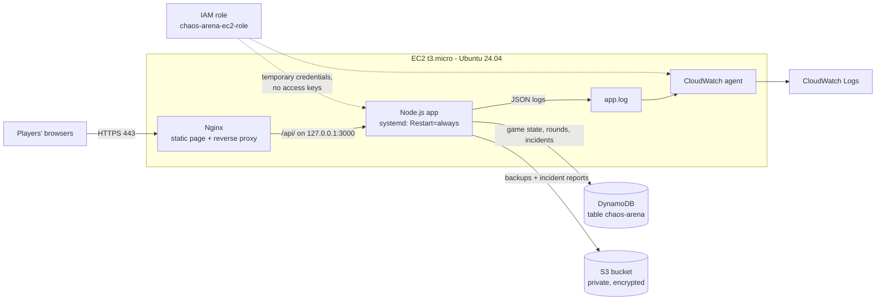

# Module 03 — Cloud Services & Web App Deployment

> **Goal:** deploy a real web application on the cloud:
> **Application Code → Cloud Compute → Database/Storage → Networking → Live Web Application**

This module turns the teaser page into the actual game. Players pull the rope, anyone can press **CHAOS** to crash the server, and it heals itself and carries on from the same score.

🌐 **Live:** https://chaos-arena.duckdns.org



## How the self-healing works

1. Someone presses **CHAOS**. The app first writes an "open incident" to DynamoDB and saves the game, then exits with an error code. That is a real crash.
2. **systemd** notices the process died and starts it again after 2 seconds (`Restart=always`).
3. The new process loads the saved game from DynamoDB, finds the open incident, and records how long the recovery took.
4. Meanwhile **Nginx** keeps serving the web page, so players see a live "self-healing…" timer instead of an error page.

## What's in this module

| Path | What it does |
|---|---|
| [`../app/`](../app/) | The game: Node.js + Express API, web page, automated tests |
| [`../infra/aws/setup-aws.sh`](../infra/aws/setup-aws.sh) | Creates the DynamoDB table, S3 bucket, IAM role and log groups (run in CloudShell) |
| [`../infra/aws/iam-policy.template.json`](../infra/aws/iam-policy.template.json) | The least-privilege permissions the server gets |
| `scripts/01-install-node.sh` | Installs Node.js 22 LTS |
| `scripts/02-deploy-app.sh` | Deploys the app, writes the settings/secret file, installs the systemd service |
| `scripts/03-configure-nginx.sh` | Switches Nginx from the teaser page to the game (reverse proxy) |
| `scripts/04-install-cloudwatch-agent.sh` | Ships app + Nginx logs to CloudWatch Logs |
| `scripts/05-verify.sh` | Tests everything, including a real crash-and-recover, and prints an evidence report |
| `systemd/chaos-arena.service` | The service definition: auto-restart, resource quotas, sandboxing |
| `nginx/chaos-arena.conf` | Nginx site: HTTPS, static files, `/api/` proxy, security headers |
| `cloudwatch/agent-config.json` | Which log files go to which CloudWatch log group |
| `notes/cloud-services-notes.md` | My learning notes for this module |

## Suggested schedule

| Session | Task | Time |
|---|---|---|
| 1 | Part A (AWS resources) + Part B (deploy) | ~45 min |
| 2 | Part C (play, break it, look inside AWS) + Part D (evidence, tag, submit) | ~45 min |

---

## Before you start: update the server's copy of the repo

SSH in (`ssh chaos-arena`) and run:

```bash
cd ~/chaos-arena && git fetch origin && git reset --hard origin/main
```

> The server's copy is read-only: it never pushes to GitHub. `reset --hard` makes it match GitHub exactly, which avoids the "local changes would be overwritten" error that a plain `git pull` can give.

---

## Part A — Create the AWS resources (CloudShell)

**CloudShell** is a terminal inside the AWS Console. It is already logged in as you and has the AWS CLI installed, so no access keys are ever created.

1. In the AWS Console, make sure the **region** (top-right) is the one your `chaos-arena` instance is in. Check **EC2 → Instances**: you should see the instance listed.
2. Click the **CloudShell** icon (`>_`) in the top bar and wait for the prompt.
3. Run these one at a time:

```bash
git clone https://github.com/l3n8n-ocd/chaos-arena.git
```
```bash
cd chaos-arena/infra/aws
```
```bash
./setup-aws.sh
```

It ends with `AWS setup complete` and a summary. It is safe to run again if anything goes wrong. 📸 **`01-cloudshell-setup.png`**: the summary.

### What it created (take a look, and a screenshot of each)

| Service | Where to look in the console | What it is for | 📸 |
|---|---|---|---|
| **DynamoDB** (managed database) | DynamoDB → Tables → `chaos-arena` | Game state, finished rounds, crash incidents | `02-dynamodb-table.png` (take this in Part C, on **Explore table items**) |
| **S3** (object storage) | S3 → `chaos-arena-<account>-<region>` → Permissions | Private, encrypted backups | `03-s3-bucket.png` (showing *Block all public access: On*) |
| **IAM** (permissions) | IAM → Roles → `chaos-arena-ec2-role` → Permissions → `chaos-arena-app-policy` | What the server may do: only its own table, bucket and logs | `04-iam-role.png` (the policy JSON) |
| **EC2** (compute) | EC2 → Instances → `chaos-arena` → **Security** tab | Shows the IAM role attached to the server | `05-ec2-role.png` |
| **CloudWatch** (monitoring) | CloudWatch → Log groups → `/chaos-arena/app` | Central log storage, 14-day retention | (in Part C) |

---

## Part B — Deploy the app (SSH)

On the server (`ssh chaos-arena`), read each script before running it.

```bash
cd ~/chaos-arena/module-03-cloud-services/scripts
```
```bash
sudo ./01-install-node.sh
```
```bash
sudo ./02-deploy-app.sh
```

Script 02 ends with a **deep health check**. Both `database` and `storage` should say `"ok": true`. That proves the server reached DynamoDB and S3 using only its IAM role.

> If it says the IAM role is missing or a check failed, wait one minute (new IAM roles take a moment to become usable) and run `sudo ./02-deploy-app.sh` again.

```bash
sudo ./03-configure-nginx.sh chaos-arena.duckdns.org
```
```bash
sudo ./04-install-cloudwatch-agent.sh
```

Open **https://chaos-arena.duckdns.org**. The game is live. 📸 **`06-game-live.png`**.

---

## Part C — Play it, break it, look inside

1. **Play:** pick a team and pull. Open the site on your phone as well and join the other team: the rope moves on both screens.
2. **Break it:** press **CHAOS** twice (the second press confirms). 📸 **`07-chaos-down.png`** while the red "Self-healing…" timer is showing, and 📸 **`08-chaos-healed.png`** when the green "Healed itself in …" message appears. The score and rope position survive the crash.
3. **DynamoDB:** DynamoDB → Tables → `chaos-arena` → **Explore table items**. You'll see `STATE / CURRENT`, one `INCIDENT` item per crash (with `recoveryMs`), and a `ROUND` item per finished round. 📸 **`02-dynamodb-table.png`**.
4. **S3:** open the bucket. There is an `incidents/` folder with one JSON report per crash, and `backups/state-latest.json` once a round has been won.
5. **CloudWatch:** CloudWatch → Log groups → `/chaos-arena/app` → open the log stream. Try the filter `{ $.msg = "recovered from crash" }`. 📸 **`09-cloudwatch-logs.png`**.

### Useful commands on the server

```bash
sudo systemctl status chaos-arena          # is it running? how many restarts?
tail -f /srv/chaos-arena/logs/app.log      # live app log (Ctrl+C to stop)
sudo systemctl restart chaos-arena         # planned restart (saves the game first)
```

Reset the scores with the secret admin token (it never leaves the server):
```bash
TOKEN=$(sudo grep '^ADMIN_TOKEN=' /etc/chaos-arena/chaos-arena.env | cut -d= -f2)
curl -s -X POST -H "Authorization: Bearer $TOKEN" http://127.0.0.1:3000/api/admin/reset
```

---

## Part D — Evidence, tag, submit

### D1. Evidence report (on the server)
```bash
cd ~/chaos-arena/module-03-cloud-services/scripts
```
```bash
sudo ./05-verify.sh chaos-arena.duckdns.org --chaos | tee ~/module-03-verify-output.txt
```
`--chaos` crashes the app on purpose and measures the recovery. Section 9 should say `RESULT: healed`.

### D2. Save evidence to GitHub (Windows PowerShell)
```powershell
cd "D:\Lenon Folder\COLLEGE LIFE\PROJECTS\chaos-arena"
```
```powershell
git pull
```
```powershell
scp chaos-arena:~/module-03-verify-output.txt .\module-03-cloud-services\evidence\verify-output.txt
```
Put your screenshots in `docs\screenshots\module-03\`:

| File | Shows |
|---|---|
| `01-cloudshell-setup.png` | `setup-aws.sh` summary |
| `02-dynamodb-table.png` | Table items (STATE, INCIDENT, ROUND) |
| `03-s3-bucket.png` | Bucket with public access blocked |
| `04-iam-role.png` | The least-privilege policy |
| `05-ec2-role.png` | Role attached to the instance |
| `06-game-live.png` | The game in the browser with the padlock |
| `07-chaos-down.png` | "Self-healing…" timer |
| `08-chaos-healed.png` | "Healed itself in …" |
| `09-cloudwatch-logs.png` | App logs in CloudWatch |

Then commit, push and tag. **Always use `git push`, never the GitHub website upload**, so the two never conflict:
```powershell
git add .
```
```powershell
git commit -m "Module 03: add verification evidence and screenshots"
```
```powershell
git push
```
```powershell
git tag module-03
```
```powershell
git push origin module-03
```

### D3. Submit on Codomax
| Deliverable | Link |
|---|---|
| **GitHub Repo** | `https://github.com/l3n8n-ocd/chaos-arena/tree/module-03/module-03-cloud-services` |
| **Live Website** | `https://chaos-arena.duckdns.org` |
| **LinkedIn Post** | your post's link |

---

## Objectives → where they're covered

| Key objective | Covered by |
|---|---|
| Compute services | EC2 instance running Node.js as a systemd service (`systemd/chaos-arena.service`) |
| Object storage | S3 bucket: private, encrypted, lifecycle rule (`app/src/backup-s3.js`, `infra/aws/setup-aws.sh`) |
| Managed databases | DynamoDB single-table design (`app/src/store-dynamo.js`) |
| Virtual networking | App bound to `127.0.0.1`, Nginx reverse proxy, security group + UFW unchanged: port 3000 is never public (`nginx/chaos-arena.conf`, verify §5) |
| IAM policies | Least-privilege role, instance profile, IMDSv2, no access keys (`infra/aws/iam-policy.template.json`, verify §4) |
| Cloud monitoring | CloudWatch Logs via the CloudWatch agent, `/api/health` + `/api/status` endpoints |
| Environment variables | All settings from the environment (`app/src/config.js`, `app/.env.example`) |
| Secrets | `ADMIN_TOKEN` generated on the server, root-only `chmod 600` file, never in Git, hidden in logs (verify §3) |
| Application logging | Structured JSON logs → file → log rotation → CloudWatch (`app/src/logger.js`) |
| Resource quotas | systemd `MemoryMax`/`CPUQuota`/`TasksMax`, per-player + per-IP rate limits, Nginx `limit_req`, DynamoDB capacity 5/5, log retention 14 days, S3 90-day expiry |
| Code → Compute → Database/Storage → Networking → Live app | Parts A → B → C |

## Run it on your own computer (optional)

No AWS needed: game data is kept in a local file.
```powershell
cd app
npm install
npm test            # 24 automated tests
npm run dev:heal    # then open http://localhost:3000 (CHAOS works here too)
```

## Troubleshooting

| Problem | Fix |
|---|---|
| `setup-aws.sh`: "No EC2 instance named 'chaos-arena'" | The console is in the wrong region. Switch region (top-right), open a **new** CloudShell, run again. |
| `02-deploy-app.sh`: IAM role not found | Run `setup-aws.sh` first; then wait a minute and retry. |
| Deep health check shows `AccessDenied` | Same: the role was only just attached. Wait a minute, re-run script 02. |
| Site shows the old teaser page | Hard-refresh (`Ctrl+F5`). If still old, re-run script 03. |
| Page loads but says "Server unreachable" | `sudo systemctl status chaos-arena` and `tail -n 30 /srv/chaos-arena/logs/app.log` |
| `git pull` on the server complains about local changes | `git fetch origin && git reset --hard origin/main` |
| No logs in CloudWatch after a few minutes | `sudo tail -n 20 /opt/aws/amazon-cloudwatch-agent/logs/amazon-cloudwatch-agent.log` and look for `AccessDenied` |

## Cost & safety notes
- Everything here stays inside the AWS free allowance: DynamoDB at 5/5 capacity units, a few KB in S3, and a few MB of logs.
- No AWS access keys exist anywhere: not in the repo, not on the server, not on your PC.
- When the project is over, `infra/aws/teardown-aws.sh` (in CloudShell) deletes everything this module created.
