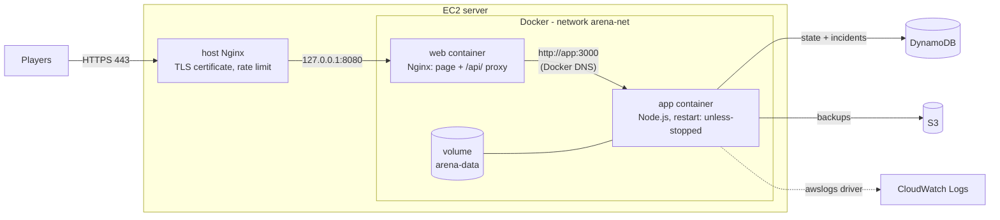

# Module 04 — Docker & Containerization

> **Goal:** containerize the web application:
> **Source Code → Dockerfile → Image → Container → Docker Compose → Running Application**

Chaos Arena now runs as two Docker containers. When someone presses **CHAOS**, the app container dies and **Docker** brings it back, usually in under a second. That's faster than systemd's ~3 s in Module 03.

🌐 **Live:** https://chaos-arena.duckdns.org



## What changed from Module 03

| | Module 03 | Module 04 |
|---|---|---|
| How the app runs | `node server.js` under systemd | Container from the `chaos-arena-app` image |
| Who restarts it after CHAOS | systemd (`RestartSec=2`) | Docker restart policy `unless-stopped` |
| Recovery time | ~3.0 s | ~0.8 s |
| Web page served by | Host Nginx from `/srv/...` | `web` container (Nginx baked into an image) |
| How the app finds Nginx / vice versa | `127.0.0.1:3000` | Docker DNS: service name `app` |
| App logs | File → CloudWatch agent | `awslogs` log driver → CloudWatch directly |
| Same setup on another machine? | Re-run every script | `docker compose up --build` |

The host Nginx stays, but only for what belongs to the server: the HTTPS certificate (renewed by certbot), the HTTP→HTTPS redirect and the request quota.

## What's in this module

| Path | What it does |
|---|---|
| [`../app/Dockerfile`](../app/Dockerfile) | Multi-stage build for the game server (deps → test → runtime) |
| [`../app/.dockerignore`](../app/.dockerignore) | Keeps `node_modules`, secrets and junk out of the build |
| [`../docker/web/Dockerfile`](../docker/web/Dockerfile) | The web container: unprivileged Nginx + the game's page |
| [`../docker/web/nginx.conf`](../docker/web/nginx.conf) | Nginx inside the container: static files, `/api/` → `app:3000` |
| [`../compose.yaml`](../compose.yaml) | Both services, network, volume, health checks, restart policy, limits |
| [`../compose.aws.yaml`](../compose.aws.yaml) | Server-only overrides: DynamoDB, secrets file, CloudWatch logging |
| `scripts/01-install-docker.sh` | Installs Docker Engine + Compose from Docker's official repo |
| `scripts/02-run-containers.sh` | Builds the images, replaces the systemd service with containers |
| `scripts/03-switch-nginx.sh` | Points the host Nginx at the web container |
| `scripts/04-verify.sh` | Evidence report, incl. a real crash that Docker heals |
| `scripts/rollback-to-systemd.sh` | Safety net: back to exactly how Module 03 was |
| `arena` | Shortcut command for Docker Compose on the server |
| `notes/docker-notes.md` | My learning notes for this module |

## Suggested schedule

| Session | Task | Time |
|---|---|---|
| 1 | Part A (CloudShell) + Part B (install Docker, run containers, switch Nginx) | ~40 min |
| 2 | Part C (explore, break it) + Part D (evidence, tag, submit) | ~40 min |

---

## Before you start: update the server's copy of the repo

`ssh chaos-arena`, then:
```bash
cd ~/chaos-arena && git fetch origin && git reset --hard origin/main
```

---

## Part A — One AWS change (CloudShell)

A container is one network "hop" further from the EC2 metadata service than the server itself. Without this change the app container can't get its IAM role credentials. `setup-aws.sh` now sets the **hop limit to 2**. Re-run it (it's safe to run again):

1. AWS Console → region **Asia Pacific (Sydney)** → open **CloudShell** (`>_`).
2. Run:
```bash
cd ~/chaos-arena && git pull && cd infra/aws && ./setup-aws.sh
```
> If CloudShell says `No such file or directory`, your old copy is gone. Run `git clone https://github.com/l3n8n-ocd/chaos-arena.git` first, then the line above.

Look for: `Instance metadata service set to IMDSv2-only (hop limit 2, for Docker).`

---

## Part B — Containerize (SSH)

On the server (`ssh chaos-arena`):

```bash
cd ~/chaos-arena/module-04-docker/scripts
```
```bash
sudo ./01-install-docker.sh
```
📸 **`01-docker-installed.png`**: the `Hello from Docker` line and the versions.

```bash
sudo ./02-run-containers.sh
```
This builds both images (1–3 minutes the first time), checks a container can use the IAM role, stops the old systemd service and starts the containers. It ends with both health checks and `"status": "ok"`.

```bash
sudo ./03-switch-nginx.sh chaos-arena.duckdns.org
```

Open **https://chaos-arena.duckdns.org**: same game, now in containers. 📸 **`05-game-live.png`**.

> **Between script 02 and 03** the site shows "healing…" for about a minute, because the old app is stopped but Nginx doesn't point at the containers yet. That's expected.
>
> **Something wrong?** `sudo ./rollback-to-systemd.sh chaos-arena.duckdns.org` puts everything back exactly as it was in Module 03. Game data is in DynamoDB, so nothing is lost.

---

## Part C — Explore it, break it

The `arena` command is a shortcut that runs `docker compose` with the right files. It always prints the full command it runs.

```bash
arena ps                          # containers, health, ports
```
📸 **`03-containers-healthy.png`**: both `(healthy)`.

```bash
sudo docker image ls | grep chaos-arena          # the two images
sudo docker history chaos-arena-app:local        # the layers of the app image
```
📸 **`02-images-built.png`**.

```bash
sudo docker network inspect chaos-arena_arena-net --format '{{range .Containers}}{{.Name}} {{.IPv4Address}}{{println}}{{end}}'
sudo docker volume ls
sudo docker exec chaos-arena-web-1 nslookup app 127.0.0.11     # Docker DNS finds "app"
```
📸 **`04-network-volume.png`**.

```bash
arena logs -f app                 # live game logs (Ctrl+C to stop)
sudo docker stats                 # live CPU/memory per container (Ctrl+C to stop)
```

**Break it:** press **CHAOS** twice on the website. It should heal in about a second. 📸 **`06-chaos-healed.png`** with the green "Healed itself in 0.x s" message.

**CloudWatch:** Log groups → `/chaos-arena/app` → stream **`app-container`**. These are the container's logs, sent by Docker itself. 📸 **`08-cloudwatch-container-logs.png`**.

### Handy commands

| Want to… | Command |
|---|---|
| Restart just the game | `arena restart app` |
| Deploy a new version after `git reset --hard origin/main` | `arena up -d --build` |
| Open a shell inside the app container | `sudo docker exec -it chaos-arena-app-1 sh` |
| See why a container stopped | `arena logs --tail 50 app` |
| Stop everything (data kept) | `arena down` |

---

## Part D — Evidence, tag, submit

### D1. Evidence report (on the server)
```bash
cd ~/chaos-arena/module-04-docker/scripts
```
```bash
sudo ./04-verify.sh chaos-arena.duckdns.org --chaos | tee ~/module-04-verify-output.txt
```
Section 10 should say `RESULT: healed` and show Docker's events: `die (exit code 1)` followed by `start`. 📸 **`07-docker-events.png`** of that section.

### D2. Save evidence to GitHub (Windows PowerShell)
```powershell
cd "D:\Lenon Folder\COLLEGE LIFE\PROJECTS\chaos-arena"
```
```powershell
git pull
```
```powershell
scp chaos-arena:~/module-04-verify-output.txt .\module-04-docker\evidence\verify-output.txt
```
Put the screenshots in `docs\screenshots\module-04\`:

| File | Shows |
|---|---|
| `01-docker-installed.png` | Docker installed, hello-world ran |
| `02-images-built.png` | Images + layers |
| `03-containers-healthy.png` | `arena ps`, both healthy |
| `04-network-volume.png` | Network, volume, Docker DNS |
| `05-game-live.png` | The game in the browser |
| `06-chaos-healed.png` | Healed in under a second |
| `07-docker-events.png` | Verify section 10 |
| `08-cloudwatch-container-logs.png` | `app-container` log stream |

Commit, push and tag with `git` only. Don't use the website upload.
```powershell
git add .
```
```powershell
git commit -m "Module 04: add verification evidence and screenshots"
```
```powershell
git push
```
```powershell
git tag module-04
```
```powershell
git push origin module-04
```

### D3. Submit on Codomax
| Deliverable | Link |
|---|---|
| **GitHub Repo** | `https://github.com/l3n8n-ocd/chaos-arena/tree/module-04/module-04-docker` |
| **LinkedIn Post** | your post's link |

---

## Objectives → where they're covered

| Key objective | Covered by |
|---|---|
| Containers vs virtual machines | `notes/docker-notes.md`; the EC2 VM runs the containers |
| Docker architecture | `notes/docker-notes.md` (client → dockerd → containerd → runc, registries) |
| Images & containers | Two images built from Dockerfiles; containers from them (verify §2–3) |
| Dockerfile optimization | Multi-stage build, cache-friendly layer order, `.dockerignore`, Alpine base, `npm ci --omit=dev`, non-root user, `HEALTHCHECK` (`app/Dockerfile`) |
| Docker commands | `notes/docker-notes.md` cheat sheet; Part C |
| Container networking | User-defined bridge `arena-net`, Docker DNS (`app`), app not published, web on `127.0.0.1` only (verify §5) |
| Volumes & persistent data | Named volume `arena-data`; state in DynamoDB so containers are disposable (verify §6) |
| Environment variables | `environment:` + `env_file:` with override rules (`compose.yaml`, `compose.aws.yaml`, verify §7) |
| Docker Compose | `compose.yaml` + server override, health-based start order, restart policy, limits |
| Source → Dockerfile → Image → Container → Compose → Running app | Parts B → C → D |

## Run it on any machine with Docker (optional)

For example in a free **GitHub Codespace**: on the repo page click **Code → Codespaces → Create codespace**, then:
```bash
docker compose up --build
```
Open port **8080**. The game uses a local volume instead of AWS, and CHAOS works the same.

## Troubleshooting

| Problem | Fix |
|---|---|
| Script 02: "containers cannot get AWS credentials" | Do Part A (re-run `setup-aws.sh` in CloudShell), then run script 02 again. |
| `arena ps` shows `unhealthy` or `restarting` | `arena logs --tail 50 app` shows why. |
| Deep check: `AccessDenied` / `CredentialsProviderError` | Same as the first row. |
| `failed to initialize logging driver` | The log group `/chaos-arena/app` must exist: re-run `setup-aws.sh`. |
| Site shows "healing…" forever | Did you run script 03? `curl -s http://127.0.0.1:8080/api/health` should answer. |
| Build is very slow or killed | t3.micro is small: check `free -h` (swap from Module 02 should be on). Run `sudo docker builder prune` to clear the build cache. |
| Want Module 03 back | `sudo ./rollback-to-systemd.sh chaos-arena.duckdns.org` |
