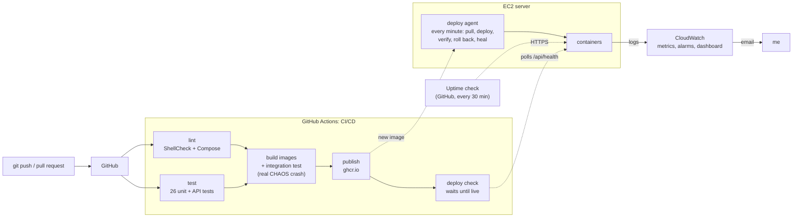

# Module 05 — DevOps, CI/CD & Monitoring

> **Goal:** automate the path from code to production, and watch it:
> **GitHub → Build → Test → Docker → Deploy → Monitor**

Every change to Chaos Arena now goes through an automated pipeline. A push to `main` is tested, built into Docker images, crash-tested for real, published, deployed to the server, and checked live, with no SSH and no manual steps. If a new version is broken, the server rolls back by itself. CloudWatch alarms email me when something goes wrong.

🌐 **Live:** https://chaos-arena.duckdns.org · ⚙️ **Pipeline:** [Actions](https://github.com/l3n8n-ocd/chaos-arena/actions)



## How a change reaches production

| Step | Where | What happens |
|---|---|---|
| 1. Pull request | GitHub | `test` + `lint` + `build` run. The integration test starts the real containers, plays, presses CHAOS and checks Docker heals the app. Merging is only sensible when everything is green. |
| 2. Merge to `main` | GitHub Actions | Same checks again, then both images are pushed to GitHub Container Registry as `sha-<commit>` and `main`. |
| 3. Deploy | EC2 server | Within a minute the **deploy agent** sees the new `main`, pulls it, and recreates the containers. |
| 4. Verify | Server + Actions | The agent waits until the containers are healthy **and** report the new commit. Otherwise it **rolls back**. The `deploy` job in Actions waits until the live site reports this commit, then smoke-tests it. |
| 5. Monitor | CloudWatch + GitHub | JSON logs become metrics; alarms email me; a dashboard shows recovery times, crashes, deploys. GitHub checks the site from outside every 30 minutes. |

**Why a "pull" deployment?** The server fetches new versions itself. GitHub never gets SSH access or AWS keys, and port 22 stays limited to my IP. The only credential in the pipeline is GitHub's own temporary token, used to publish images.

## What's in this module

| Path | What it does |
|---|---|
| [`../.github/workflows/ci-cd.yml`](../.github/workflows/ci-cd.yml) | The pipeline: test → lint → build + integration test → publish → deploy check |
| [`../scripts/ci/integration-test.sh`](../scripts/ci/integration-test.sh) | End-to-end test with real containers, incl. a CHAOS crash |
| [`../.github/workflows/uptime.yml`](../.github/workflows/uptime.yml) | Scheduled outside-in uptime check |
| [`../.github/dependabot.yml`](../.github/dependabot.yml) | Automatic dependency-update pull requests |
| `arena-deploy` | The server's deploy agent: heal → check → deploy → verify / roll back |
| `systemd/` | Timer that runs the agent every minute, plus log rotation |
| `cloudwatch/agent-config.json` | Ships the agent's log to CloudWatch |
| [`../infra/aws/setup-monitoring.sh`](../infra/aws/setup-monitoring.sh) | CloudWatch metric filters, 7 alarms, email alerts, dashboard |
| `scripts/01-install-deploy-agent.sh` | Connects the server to the pipeline |
| `scripts/02-verify.sh` | Evidence report, incl. an optional "frozen app" self-healing test |
| `notes/devops-notes.md` | My learning notes for this module |

---

## Your steps (about 60 minutes)

### Step 1 — Make the two images public (GitHub, 2 minutes)
The pipeline published `chaos-arena-app` and `chaos-arena-web` to your GitHub packages. The server downloads them without logging in, so they must be **public**. For **each** link: scroll to **Danger Zone → Change visibility → Public**, then type the name to confirm.
- https://github.com/users/l3n8n-ocd/packages/container/chaos-arena-app/settings
- https://github.com/users/l3n8n-ocd/packages/container/chaos-arena-web/settings

📸 **`03-ghcr-packages.png`**: your profile → **Packages** tab, showing both.

### Step 2 — Monitoring (AWS CloudShell, Sydney region)
```bash
cd ~/chaos-arena && git pull && cd infra/aws && ./setup-monitoring.sh YOUR-EMAIL@example.com
```
Then open the email from **AWS Notifications** and click **Confirm subscription**.

### Step 3 — Connect the server (SSH)
```bash
cd ~/chaos-arena && git fetch origin && git reset --hard origin/main
```
```bash
sudo ./module-05-cicd/scripts/01-install-deploy-agent.sh
```
It ends with the agent's first deploy (`deploy_succeeded`) and the live version. Refresh the website: the footer now shows `build xxxxxxx`.

### Step 4 — Ship a change through the pipeline (GitHub website, 10 minutes)
This shows the whole Git workflow: branch → pull request → checks → merge → automatic deploy.

1. On GitHub open `app/public/index.html` → click the ✏️ pencil (Edit).
2. Change the tagline line, e.g. `A multiplayer tug-of-war you're <em>allowed</em> to break.` → `A multiplayer tug-of-war you're <em>allowed</em> to break. Go on, try it.`
3. **Commit changes…** → choose **Create a new branch for this commit and start a pull request** → **Propose changes** → **Create pull request**.
4. Wait for the checks (about 3–4 minutes) to turn green. 📸 **`02-pull-request-checks.png`**.
5. **Merge pull request** → **Confirm merge**.
6. Open the **Actions** tab and the new **CI/CD** run on `main`. Wait for all jobs, including **Deploy to production**, to turn green. 📸 **`01-pipeline-green.png`** (the run's graph) and scroll down for the summary.
7. Refresh the website: your new tagline and a new `build` number are live. 📸 **`04-deploy-live.png`**.

### Step 5 — Watch it (2 minutes, then a short wait)
- On the website, press **CHAOS** a few times (60 s cooldown between presses) and play a round or two, so the charts have data.
- Run the evidence report **with the freeze test**: it freezes the app without crashing it, and the agent heals it, which also fires an alarm email:
```bash
sudo ./module-05-cicd/scripts/02-verify.sh --freeze | tee ~/module-05-verify-output.txt
```
- 📸 **`05-cloudwatch-dashboard.png`**: CloudWatch → Dashboards → **chaos-arena** (the link is printed by `setup-monitoring.sh`; give it 5 minutes after the crashes).
- 📸 **`06-alarm-email.png`**: the "ALARM: chaos-arena-container-healed" email.
- 📸 **`07-uptime-check.png`**: Actions → **Uptime check** → **Run workflow** → open the run → the summary table.

### Step 6 — Evidence, tag, submit (Windows PowerShell)
```powershell
cd "D:\Lenon Folder\COLLEGE LIFE\PROJECTS\chaos-arena"
```
```powershell
git pull
```
```powershell
scp chaos-arena:~/module-05-verify-output.txt .\module-05-cicd\evidence\verify-output.txt
```
Put the screenshots in `docs\screenshots\module-05\`, then:
```powershell
git add .
```
```powershell
git commit -m "Module 05: add verification evidence and screenshots"
```
```powershell
git push
```
```powershell
git tag module-05
```
```powershell
git push origin module-05
```
> Your push to `main` also runs the pipeline and redeploys. That's expected, and it's more evidence that the pipeline works.

**Submit on Codomax:**

| Deliverable | Link |
|---|---|
| **GitHub Repo** | `https://github.com/l3n8n-ocd/chaos-arena/tree/module-05/module-05-cicd` |
| **LinkedIn Post** | your post's link |

---

## Objectives → where they're covered

| Key objective | Covered by |
|---|---|
| DevOps culture | Automation over manual steps, small changes via pull requests, fast feedback, "you build it, you run it" monitoring (`notes/devops-notes.md`) |
| Git/GitHub workflows | Branch → pull request → required checks → merge → deploy (Step 4), Dependabot PRs, tags per module |
| Continuous Integration | `test` + `lint` + `build` on every push and PR |
| Automated testing | 26 unit/API tests + container integration test with a real crash |
| Build automation | Multi-stage Docker builds with layer caching (`type=gha`), images tagged by commit |
| Deployment automation | Publish to GHCR → pull-based deploy agent → health-gated rollout → automatic rollback |
| Environment management | Local (`docker compose up`), CI (runner, file store), production (EC2, DynamoDB, secrets file); GitHub `production` environment with URL |
| GitHub → Build → Test → Docker → Deploy → Monitor | The pipeline + agent + CloudWatch, end to end |
| Basic logs & observability | JSON logs → CloudWatch metric filters → alarms + dashboard; deploy history log; uptime checks |

## Troubleshooting

| Problem | Fix |
|---|---|
| Install script: "cannot download … images" | Do Step 1 (make both packages public). Check the pipeline on `main` is green. |
| `Deploy to production` job fails after 10 min | The agent rolled back or isn't running: `sudo journalctl -u arena-deploy -n 30` and `tail /srv/chaos-arena/logs/deploy.log` |
| `Deploy to production` says "skipped" | Normal until Step 3 is done (the server didn't report versions yet). |
| No alarm email | Confirm the SNS subscription email; check spam. |
| Dashboard charts empty | They fill from log lines: press CHAOS / play, wait ~5 minutes, refresh. |
| Want to stop automatic deploys | `sudo systemctl disable --now arena-deploy.timer` |
| Roll back by hand | `echo sha-<older> \| sudo tee /var/lib/chaos-arena/deployed-tag && arena up -d` |
