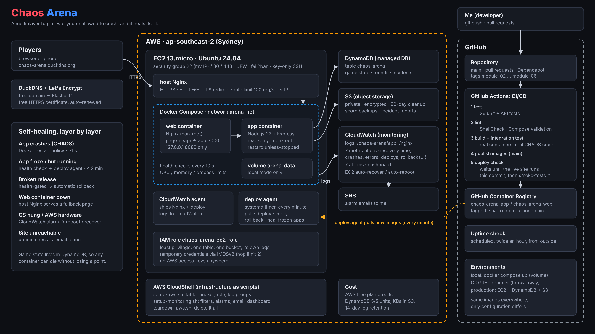

# Module 06 — Capstone: Chaos Arena

> **Build, containerize, automate, deploy and monitor a real application**
> Cloud Infrastructure + Git + Docker + CI/CD Pipeline + Active Monitoring + Managed DB/Auth

**Chaos Arena** is a multiplayer tug-of-war with one unusual feature: a **CHAOS** button that really crashes the production server. The project's goal was to make that crash a non-event: the system detects it, heals itself, keeps every point scored, and records how long it took.

| | |
|---|---|
| 🌐 **Live application** | https://chaos-arena.duckdns.org |
| 💻 **Source code** | https://github.com/l3n8n-ocd/chaos-arena |
| ⚙️ **CI/CD pipeline** | https://github.com/l3n8n-ocd/chaos-arena/actions |
| 🐳 **Docker / Compose** | [`app/Dockerfile`](../app/Dockerfile) · [`docker/web/Dockerfile`](../docker/web/Dockerfile) · [`compose.yaml`](../compose.yaml) · [`compose.aws.yaml`](../compose.aws.yaml) |
| 🗺️ **Architecture diagram** | [`docs/architecture.svg`](../docs/architecture.svg) (below) |

---

## Final submission checklist

| Required | Where |
|---|---|
| GitHub repository | https://github.com/l3n8n-ocd/chaos-arena (one tag per module: `module-02` … `module-06`) |
| Cloud deployment link | https://chaos-arena.duckdns.org (AWS EC2, Sydney) |
| Docker / Compose config | `app/Dockerfile`, `docker/web/Dockerfile`, `compose.yaml`, `compose.aws.yaml` |
| CI/CD pipeline | `.github/workflows/ci-cd.yml` (+ `uptime.yml`, `dependabot.yml`) |
| Architecture diagram | `docs/architecture.svg` / `docs/architecture.png`, plus the Mermaid diagram in the main README |

## Capstone requirements → implementation

| Requirement | Implementation |
|---|---|
| **Build** a real application | Node.js + Express REST API and a vanilla-JS web page: tug-of-war, rounds, live player counts, crash statistics. 26 automated tests. |
| **Containerize** | Multi-stage, non-root, read-only images; two-service Compose stack with health checks, a private network, a volume and resource limits |
| **Automate** | GitHub Actions: test → lint → build → integration test (real crash) → publish → deploy check. Dependabot for updates. AWS resources created by scripts. |
| **Deploy** | Pull-based continuous deployment: a server agent rolls out each new `main` build within a minute, health-gated, with automatic rollback |
| **Monitor** | CloudWatch Logs (JSON), 7 metric filters, 7 alarms with email, a dashboard, EC2 auto-recover/reboot, outside-in uptime checks |
| **Cloud infrastructure** | EC2, Elastic IP, security group, VPC networking, IAM, DynamoDB, S3, CloudWatch, SNS on AWS; DuckDNS + Let's Encrypt |
| **Git** | Branch → pull request → status checks → merge; tags per milestone; images traceable to their commit |
| **Managed DB** | Amazon DynamoDB holds all game state, so containers are disposable |
| **Managed auth** | AWS IAM role for the server (temporary credentials via IMDSv2, no keys anywhere); GitHub's per-run `GITHUB_TOKEN` for publishing; secret admin token for game resets |
| **Active monitoring** | Alarms that act: email me, restart frozen containers, roll back bad releases, reboot/recover the VM |

## How it was built: one layer per module

| Module | What it added | Crash recovery | Evidence |
|---|---|---|---|
| [02 Linux & Networking](../module-02-linux-networking/) | Hardened Ubuntu server, firewall layers, DNS, HTTPS | — | [report](../module-02-linux-networking/evidence/verify-output.txt) · [screens](../docs/screenshots/module-02/) |
| [03 Cloud Services](../module-03-cloud-services/) | The game; DynamoDB, S3, IAM role, CloudWatch Logs; systemd service | **~3.0 s** (systemd) | [report](../module-03-cloud-services/evidence/verify-output.txt) · [screens](../docs/screenshots/module-03/) |
| [04 Docker](../module-04-docker/) | Two containers, Compose, hardening, container networking | **~1.3 s** (Docker) | [report](../module-04-docker/evidence/verify-output.txt) · [screens](../docs/screenshots/module-04/) |
| [05 CI/CD & Monitoring](../module-05-cicd/) | Pipeline, deploy agent, rollbacks, alarms, dashboard | ~1.3 s + freeze healing + rollback | [report](../module-05-cicd/evidence/verify-output.txt) · [screens](../docs/screenshots/module-05/) |
| 06 Capstone | This write-up, architecture diagram, final polish | | |

## Reliability results

| Failure | How it's handled | Measured |
|---|---|---|
| App process crash (CHAOS button) | Docker restart policy; state reloaded from DynamoDB | 0.8 s (test machine) · ~1.3 s (t3.micro) |
| App frozen but still running | Docker health check → deploy agent restarts it | < 1 min after Docker marks it unhealthy |
| Broken release | Health-gated rollout → automatic rollback, bad version blocked | rolled back in 9 s (crash-looping release) |
| Web container down | Host Nginx serves a fallback copy of the page; API answers JSON 503 | instant |
| OS hung / AWS hardware fault | CloudWatch alarm → EC2 reboot / recover | minutes (AWS) |
| Whole site unreachable | GitHub uptime check → email | ≤ 30 min |

Every crash is recorded in DynamoDB with its recovery time, shown live on the page, backed up to S3, and charted on the CloudWatch dashboard.

## Security summary

- **Network:** only 80/443 public; SSH only from my IP, key-only, no root, fail2ban. Containers are reachable only via `127.0.0.1`. The app container publishes no ports at all.
- **Identity:** no long-lived cloud credentials anywhere. The server uses an IAM role (least privilege, IMDSv2). CI uses a per-run token. Deploys are *pulled* by the server, so GitHub has no access to it.
- **Secrets:** generated on the server, in a root-only file, injected at runtime; never in Git or in an image (`docker history` verified).
- **Containers:** non-root users, read-only filesystems, all Linux capabilities dropped, `no-new-privileges`, CPU/memory/process limits.
- **Web:** HTTPS with HSTS, CSP and other security headers, rate limits at Nginx and in the app, request size limits, input validation.
- **Supply chain:** pinned base images from AWS ECR Public, `npm ci` from a lockfile, Dependabot updates through CI.

## Cost
Runs on the AWS Free plan's credits: one t3.micro, a 20 GB disk, an Elastic IP, DynamoDB at 5/5 capacity units, a few KB in S3, logs kept 14 days, and 7 alarms. GitHub Actions and GitHub Container Registry are free for public repositories. `infra/aws/teardown-aws.sh` removes all the AWS resources.

## Operations runbook

| Task | Command (on the server) |
|---|---|
| Status of everything | `arena ps` · `systemctl list-timers arena-deploy.timer` |
| Live app logs | `arena logs -f app` |
| Deployment history | `tail -n 20 /srv/chaos-arena/logs/deploy.log` |
| Pause automatic deploys | `sudo systemctl disable --now arena-deploy.timer` |
| Roll back by hand | `echo sha-<old> \| sudo tee /var/lib/chaos-arena/deployed-tag && arena up -d` |
| Reset the scores | see Module 03 README (admin token never leaves the server) |
| Back to Module 03 (no Docker) | `sudo module-04-docker/scripts/rollback-to-systemd.sh chaos-arena.duckdns.org` |

## Lessons learned

1. **State is what makes healing possible.** Restarting a process is easy; restarting it *without losing anything* needs the state outside it (DynamoDB).
2. **"Running" isn't "working".** Docker's restart policy ignores a frozen app. Health checks plus something that acts on them closed that gap.
3. **Every layer has a different failure.** Process, container, release, VM and network each needed their own detection and fix.
4. **Small details break containers on AWS:** IMDS hop limit 2, Docker bypassing UFW, a proxy hop changing visitors' IPs, and Nginx caching a container's old IP.
5. **Automation needs a safety net.** Continuous deployment only felt safe once rollbacks were automatic and tested with a deliberately broken release.

## What I'd do next
- A second instance behind a load balancer for zero-downtime blue/green deploys.
- Infrastructure as code with Terraform or CloudFormation instead of CLI scripts.
- Real player accounts with Amazon Cognito; WebSockets instead of polling.
- Tracing (AWS X-Ray / OpenTelemetry) and SLOs with an error budget.
